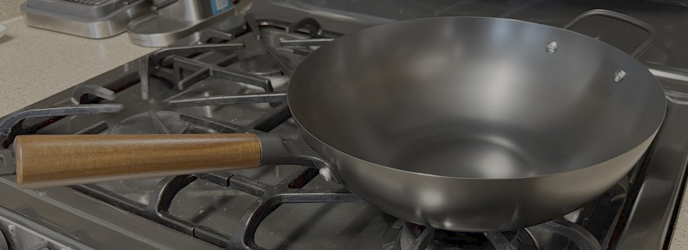
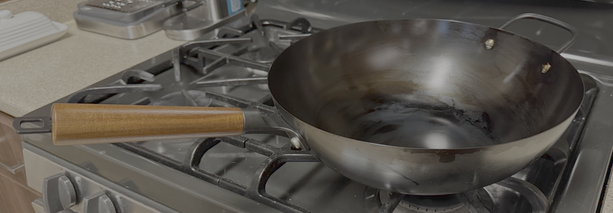
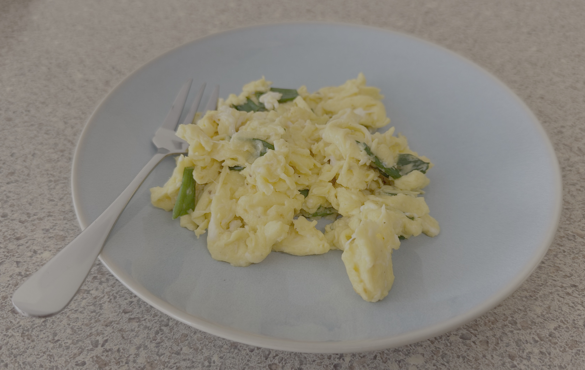
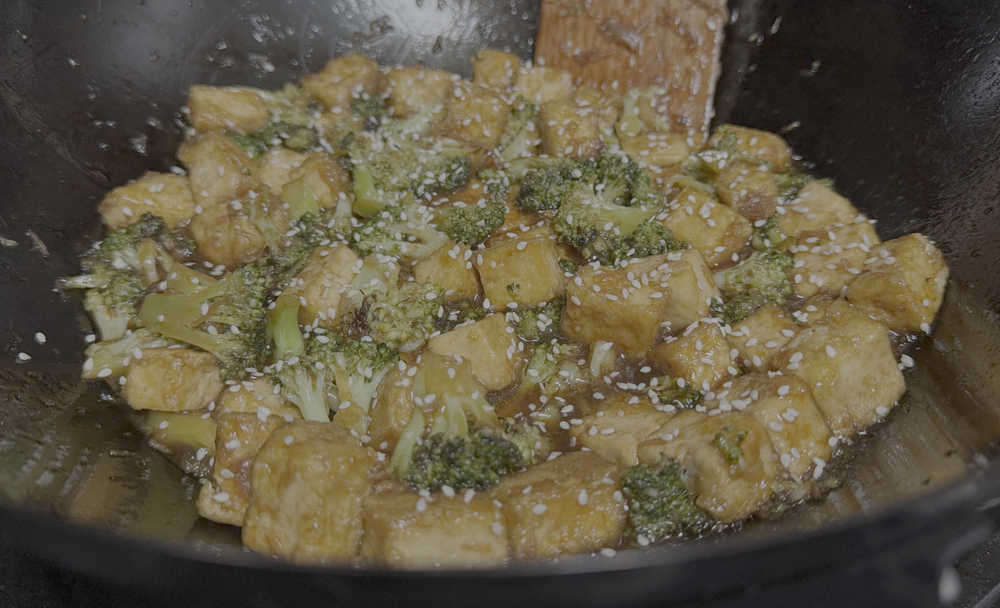

## Backstory

I got tired of making stir-fry dishes in a stainless steel pot, cranking the heat up high, only for the pot to get burn marks while the actual contents just...boiled.

I've never owned my own wok before. I did a lot of research on which wok to buy. The internet says to go to your local Asian grocery store and buy the cheapest carbon steel wok you could find. I did that and found some, but I found the woks to be a bit too cheap-looking and a bit too big. All of the carbon steel ones were 14 inches, which I know is the standard, but it just felt a *tad* too large.

Then, while scrolling through Amazon, I stumbled upon the [12.6 in. Amazon Basics Carbon Steel Pre-Seasoned Wok](https://www.amazon.com/dp/B0F183GV33). This seemed to check every box:

- ✅ Carbon steel
- ✅ Preseasoned
- ✅ Lightweight (2.5 lbs, norm is 3-4 lbs)
- ✅ Cheap (fluctuates within $30-50)
- ✅ Handle comes off (for oven seasoning - more on that below)

However, I was a bit skeptical of purchasing an Amazon Basics wok. It seemed a bit *too* quality for the price, but I bit the bullet and bought it anyway. I'm happy to tell you that I absolutely love it!

I first tried seasoning it using the gas stove, but I used too much oil and not enough time on the heat, resulting in some oil spots partially polymerizing and becoming gummy/sticky. Rookie mistake. Between inhaling the fumes of burning oil and how long I was supposed to stand there, holding the wok above the flame, I decided that seasoning it in the oven would be much easier.

However, I couldn't really find a guide on "how to season a preseasoned wok in the oven", as the instructions online were mainly for seasoning a brand new wok on the stovetop. So for those who have bought a preseasoned wok - here's an oven seasoning guide for you!

## Oven Seasoning Instructions
1. Wash your wok with a non-abrasive brush/sponge and hot water. A little dish soap won't hurt, since the factory seasoning is really baked on.
2. Wipe it dry. Heat it over the stove on medium heat for 10 minutes to make sure all water evaporates.
3. Let the wok cool for 10 minutes. While it's cooling, unscrew the wooden handle, as any wooden parts will burn in the oven.
4. Adjust racks in oven to have one in the center and the other below it. Lay a sheet pan or tin foil on the bottom rack to catch oil.
5. Preheat oven to 500°F.
6. Use a high smoke point oil like canola or vegetable oil. Pour just one tablespoon into the wok.
7. Grab a microfiber cloth (works best) or folded paper towel and coat the entire inner surface with the oil evenly. You can also wipe the outer surface as well for extra rust protection.
8. Grab another microfiber cloth / paper towel. Attempt to wipe all the oil off, as if you're trying to get it completely clean. I promise that it won't fully come off! You want a razor thin layer of oil.
9. Place the wok upside-down in the oven on the center rack. Bake for 45 minutes.
10. After 45 minutes, turn off the oven and let it cool inside the oven for an hour.

Voila! An evenly seasoned, perfectly smooth wok. If you want to, repeat this process 2-3 more times.

## The Result
The next day, I made the best scrambled eggs I've ever made in my life. I preheated the wok on high, and then added a tiny bit of oil, and then the eggs. Kept it moving constantly on high heat. It was mind-blowing how nonstick it was - all natural, no PFAS or chemical coatings! Stainless steel is great, but man, those eggs *love* to stick to stainless steel.

For dinner, I made a delicious tofu broccoli stir fry. Usually, the cornstarch-coated tofu sticks while pan-frying. But not in this wok!

I'm extremely happy with the Amazon Basics wok - it exceeded my expectations, and I'd recommend it wholeheartedly. I'm looking forward to using it as my primary cooking vessel and making delicious food!